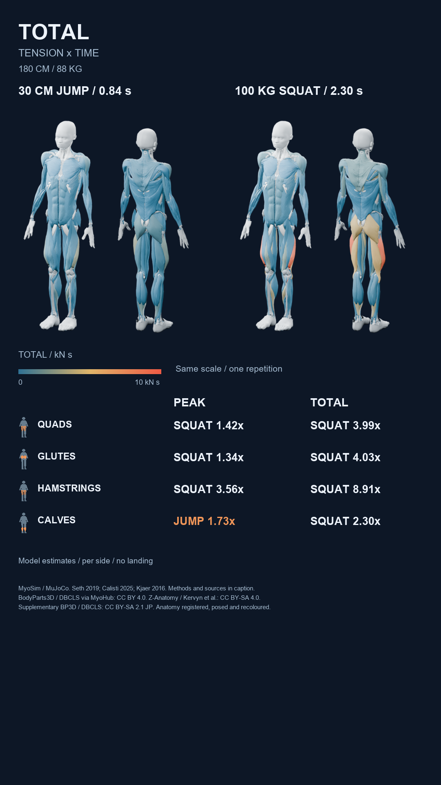
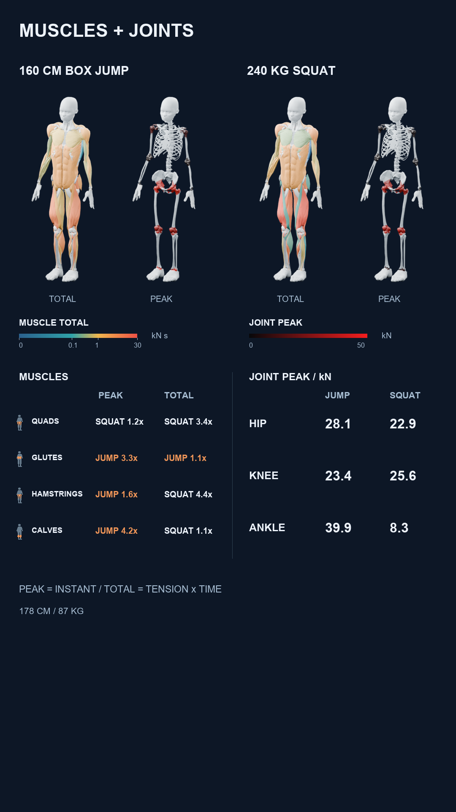

# Exercise Mechanics Lab

Final exercise-mechanics studies: videos, key results and concise method notes.

## Standing long jump · fixed torque limits

**3.009 m minimum, stable at all four tested time steps.** Same 178 cm / 87 kg virtual body and net joint torque limits. PPO was followed by numerical refinement of landing posture; this is a feasible checked result, not a proven global optimum.

[Watch / download · 59.8 seconds](media/standing-long-jump.mp4) · [Final numerical result](results/standing-long-jump.json)

## Bodyweight jump vs 100 kg squat

A 30 cm takeoff-to-apex centre-of-mass rise and a 100 kg squat in the same 180 cm / 88 kg model. Peak tension and tension integrated over physical time describe different loading patterns.

[Watch / download · 26 seconds](media/jump-vs-100kg-squat.mp4) · [Final result](results/jump-vs-100kg-squat.json)

## Box jump vs heavy squat

Reference-motion comparison of conditional muscle tension and joint reaction resultants. The 15-second analysis cut retains both motion passes and the combined conclusion, with the photographic opening omitted.

[Watch / download · 15 seconds](media/box-jump-vs-squat.mp4) · [Final result](results/box-jump-vs-squat.json)

These are virtual mechanics experiments. Muscle forces depend on the model and force-sharing assumptions; they are not measured EMG, fatigue, injury or individual-athlete predictions.

[Method and interpretation](METHOD.md) · [Models and credits](CREDITS.md) · [Preserved analysis code](https://github.com/tmdals1213-cyber/exercise-mechanics-lab/tree/lab-source)

The main branch contains final results and media only. Source, configuration and earlier reproducibility notes remain in `lab-source`. Raw optimization runs and intermediate render caches are not included.
