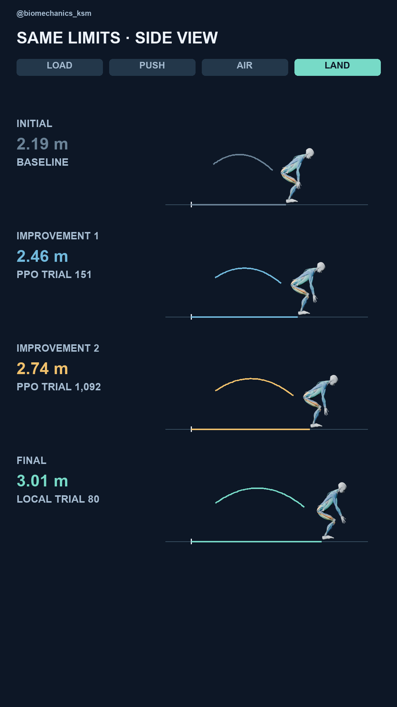

# Exercise Mechanics Lab

Qualified virtual result: **3.0090 m minimum across four time steps, all stable**. See `examples/long_jump/final_validation.json` and `search_counts.json`.

Rigid-body exercise simulations, conditional muscle-tension analysis, and portrait visualizations. The current study uses PPO to improve standing-long-jump posture and timing under fixed virtual joint-torque limits.



## Included

- `scripts/`: physics, inverse analysis, training, rendering and archived experiment tools.
- `scenarios/`: movement and model assumptions.
- `examples/long_jump/`: finalized study video, four-view comparisons and reproducible checked inputs.
- `examples/box_jump_vs_squat/`: final analysis excerpt, summary and metrics.
- `docs/`: method, storage policy, reproducibility notes and upstream credits.
- `asset_manifest.json`: external model paths, sizes and SHA-256 hashes.

## Binary bundle status

The checked input/video ZIP is prepared locally. GitHub Release asset upload is pending; the default release download URL is not live yet. Source, configuration, numerical evidence and previews are available here. If you already have `exercise-mechanics-github.zip`, run `python scripts/download_example.py --archive /path/to/exercise-mechanics-github.zip`. Large inputs and videos are intentionally excluded from the Git tree.

## Quick checks

Python 3.12 was used locally. From the repository root:

```sh
python -m venv .venv
python -m pip install -r requirements/analysis.txt
python -m compileall -q scripts
```

Open the example MP4s directly, or run the registered mechanical example:

```sh
python scripts/download_example.py
python scripts/analyze_example.py --dt 0.0005
python scripts/analyze_example.py --dt 0.0005 --set push_s=0.24 --output results/faster_push
python scripts/analyze_muscle_example.py
```

The compact input includes a pinned-version compiled model, contact definitions and parameters; it requires no historical rollout files. The inverse example re-solves the supplied fixed-motion moment-arm/torque problem. The forward example and fixed inverse fixture use the same finalized motion. After changing forward motion, do not reuse this fixed inverse operator: recompute muscle paths and targets with the anatomical pipeline. The exact source timestep is recorded in `prepared_model.json`; `--dt` also supports independent timestep comparisons. Rebuilding the anatomical rig or recomputing its full muscle paths additionally requires the external assets in the manifest. Read `docs/REPRODUCIBILITY.md` before running training. `requirements/legacy-opensim.txt` records dependencies of the earlier OpenSim experiments and is separate from the native MuJoCo/PPO environment.

## Optional fresh learning run

```sh
python -m pip install -r requirements/native.txt
python scripts/start_example_training.py --episodes 48 --hours 1
```

This starts a fresh small PPO run from the registered mechanics, not from the original learned checkpoint. It does not promise the historical3m result in48 trials. Its workers use the supplied model, so the historical registration corpus is unnecessary. Longer runs are opt-in; completed trials and actual policy updates are distinct.

## Current method

The reduced model has three unactuated sagittal root coordinates and eleven internal joint torques. A 9→64→64→58 policy selects a whole-jump parameter sequence: posture/timing and five families of three-knot equivalent torque drive. PD/state feedback executes the sequence. Contacts generate ground reactions; no takeoff impulse or airborne centre-of-mass path is prescribed. Internal air control changes posture, not the ballistic COM path.

The target is retained landing distance ≥3.000 m with stable recovery at each of 0.5, 0.25, 0.125 and 0.0625 ms. Training stops only after all four pass. Numerical eligibility also includes conservation/ROM checks and a heuristic pre-takeoff ground-reaction screen below 5.5 bodyweights; that screen is a modelling choice, not a universal human capacity law. It is kept fixed during the final search. Read `examples/long_jump/latest_checked_snapshot.json` for actual progress; the included video shows the finalized case, while its approved opening preserves an earlier training snapshot.

The final search also uses bounded physical pattern search and continuation from the best four-step-stable PPO sample. Proposals are ranked by the minimum retained distance across all four time steps, with stability and eligibility required in each. A successful screen is repeated from rest without launch caching. This supplemental numerical search is counted separately from PPO trials and policy updates; final example provenance states which method found the result. Body properties, torque limits, contact settings and qualification thresholds remain fixed.

Muscle forces are separate inverse postprocessing: 438 model paths, net torque/support equilibrium, nonnegative force sharing and continuity. These conditional forces do not drive the learner and are not measured activation, fatigue, injury or validated individual-human force predictions.

## Examples and trial counts

The four-case video layout uses baseline → two intermediate improvements → final qualified candidate. `PPO TRIAL n` counts completed V3 PPO rollouts including failures. Worker episode numbers, verification reruns, CEM and recentering are excluded. Earlier inherited training is recorded separately. See `trial_provenance.json`; an older preview's final slot is replaced only after the target is qualified.

## Project status

This is an experimental research/visualization workspace. Core modules use repository-relative paths, while some archived experiment scripts retain local historical paths. The portability report lists them. Raw rollouts, checkpoints, render frames, machine environments and external anatomy source archives are excluded from the upload folder. No remote upload is performed by preparing this folder.

See `LICENSE_NOTICE.md` and `docs/upstream_notices` before distributing derived assets.
